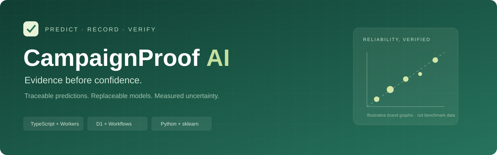
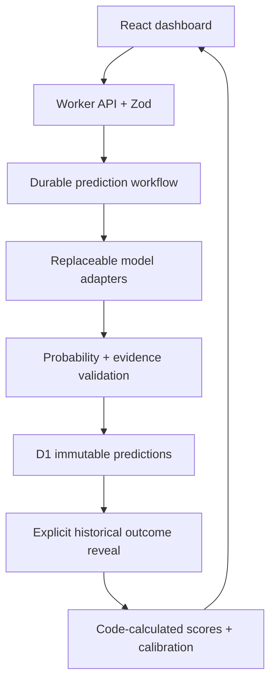

<div align="center">



# CampaignProof AI

**Calibrated Customer Response Prediction with Replaceable LLM Decision Models**

A small, reproducible AI engineering project that asks a useful business question:<br/>
*How well do different models estimate customer response when checked against historical outcomes?*


[Quick start](#quick-start) · [Measured results](#measured-results) · [Architecture](#architecture) · [Failure study](#llm-failure-case-study) · [Methodology](docs/METHODOLOGY.md)

</div>

> **Status:** locally verified MVP. Genuine UCI data. Claude and Workers AI integrations implemented, with transport-stubbed tests; live LLM benchmarks and public deployment have **not** been run. The project title refers to calibration-aware evaluation, not a claim that its models are well calibrated.

## Why this exists

A small marketing team can obtain a score from a statistical model or a probability from an LLM, but neither is useful evidence until it is compared with an observed outcome. Different providers also make comparison awkward when their response shapes, explanations, costs and failure behavior differ.

CampaignProof uses one prediction contract and one evaluation path. It stores the prediction first, reveals the matching historical label afterward, and computes the metrics in code. An LLM is never allowed to supply conversion counts, aggregate performance or historical facts.

This is a historical Portuguese banking backtest, not an Indian consumer model, a future-performance promise, or evidence that a campaign caused a subscription.

## What you can do

| Capability | Implementation |
|---|---|
| Compare replaceable models | Training base rate, Logistic Regression, deterministic mock, Claude API and one Workers AI open-weight model |
| Check numerical output | Strict Zod schema, finite [0,1] probabilities, matching sample ID, enumerated reasons and exact attribute/value evidence |
| Trace a prediction | Input snapshot and SHA-256, dataset/model/prompt versions, timestamps, provider status, attempts, usage and cost metadata |
| Run durable steps | Cloudflare Workflows with bounded provider retries, failure states and idempotent D1 persistence |
| Score against reality | Brier score, declared-threshold accuracy, ten-bin reliability, shared valid sample intersection and failure coverage |
| Inspect the result | Four-section React dashboard: Run Prediction, Model Comparison, Calibration and Run Inspector |

Offline operation requires no cloud account or paid model. Mock responses are visibly labeled and are never presented as real LLM output.

## Architecture



D1 keeps samples, hidden historical labels, runs, predictions and revealed outcomes in separate tables. A composite key prevents duplicate prediction writes; database triggers reject prediction edits/deletes and premature outcome inserts. These are application integrity controls, not protection against an administrator changing the database.

Provider calls have a 15-second timeout and at most three attempts. Network failures, 429s and 5xx responses may retry; malformed output and authentication errors do not. Workflow prediction steps add no second provider retry layer. Storage retry is safe; external paid requests cannot be guaranteed exactly once after an uncheckpointed crash.

## Measured results

Verified locally on 23 October 2026 with Node 24.19.0, Wrangler 4.152.0, Python 3.12, pandas 2.3.3 and scikit-learn 1.7.2. See [raw evaluation](artifacts/evaluation.json), [Vitest output](artifacts/vitest-output.txt), [pytest output](artifacts/pytest-output.txt), [API output](artifacts/api-output.txt) and [local workflow report](artifacts/local-smoke.json).

### Full historical statistical benchmark

Source-order split: **24,712 training / 8,238 validation / 8,238 test** records. Fixed model configuration; preprocessing learns from training only. Accuracy threshold: **0.5**.

| Model | Test records | Brier ↓ | Accuracy |
|---|---:|---:|---:|
| Training base-rate predictor | 8,238 | 0.280993 | 69.17% |
| Logistic Regression | 8,238 | 0.262779 | 68.32% |
| Claude | Not run | — | — |
| Workers AI open model | Not run | — | — |

**Interpretation matters:** Logistic Regression has lower Brier loss but lower threshold accuracy. Training prevalence is **4.81%**, while test prevalence is **30.83%**. This is substantial temporal drift; neither model is established as a reliable future predictor. Validation Logistic Regression Brier: 0.097789. No claim is made that an LLM improves on either baseline.

Python-exported scoring differed from scikit-learn by at most **2.22 × 10⁻¹⁶** over the full test partition. The independent TypeScript test checks **256 Python probability references** at an absolute tolerance of **10⁻¹²**.

### Local Worker + D1 + Workflow comparison

A separate **20-record** sample (seed 474) from a fixed 500-record held-out pool was used for integration. These are different records from the full benchmark cohort above.

| Model | Shared valid records | Brier ↓ | Valid coverage | Invalid / errors | Model API charge |
|---|---:|---:|---:|---:|---|
| Training base rate | 20 | 0.363852 | 100% | 0 / 0 | $0, local compute excluded |
| Logistic Regression | 20 | 0.285587 | 100% | 0 / 0 | $0, local compute excluded |
| Deterministic mock | 20 | 0.280862 | 100% | 0 / 0 | $0, fixture only |

Local median / p95 adapter timings were **0 / 0 ms** (Logistic Regression), **0 / 1 ms** (constant), and **0 / 0.05 ms** (mock, interpolated p95). Most readings are zero at the Worker event clock's available resolution; these do not establish instantaneous execution or measured microsecond performance. Real-provider latency and billing remain unmeasured. The arbitrary mock's Brier value is an interface demonstration, not evidence of LLM capability. Twenty records cannot support a reliable calibration conclusion.

### Verification

| Check | Actual result |
|---|---|
| Dependency installation | Passed |
| TypeScript / lint | Passed |
| Vite production build + Worker bundle dry-run | Passed; no deployment |
| Vitest | **38 passed, 0 failed, 0 skipped** |
| pytest | **12 passed, 0 failed, 0 skipped** |
| Local integrated API check | **21 assertions passed** |
| D1 migrations and seed | Applied with local Wrangler D1 |
| Durable workflow | Completed; 60 predictions across 20 samples × 3 models |
| Prediction/outcome separation | Verified hidden before explicit scoring |
| Duplicate request / repeated scoring | Verified idempotent |
| Live Claude / Workers AI calls | Not run; no paid benchmark authorized |
| Public Cloudflare deployment | Not run |
| Browser screenshot / visual QA | Not captured; Chromium download unavailable in this environment |
| GitHub Actions | No remote CI result claimed |

## Quick start

Prerequisites: Node 24 LTS and Python 3.12. The genuine dataset, scorer and seed SQL are included.

```bash
npm ci
python -m venv .venv
# Windows: use .venv\Scripts\python.exe for the next Python commands.
# macOS/Linux: use .venv/bin/python.
python -m pip install -r ml/requirements.txt
python ml/prepare.py
npm run db:migrate
npm run db:seed
npm run build
npm run dev
```

Open **http://127.0.0.1:8787**. Run a comparison with size 20 and seed 474. After completion, inspect saved predictions, then click **Reveal outcomes & score**. Before reveal, the outcome is hidden. The baseline and base-rate predictor always participate.

Use a second terminal with `npm run dev:web` for Vite hot reload. Full [Windows PowerShell instructions](docs/WINDOWS_SETUP.md) avoid execution-policy changes and include troubleshooting. No public deployment occurs in any quick-start command; `build` uses Wrangler's dry-run.

## Model-provider contract

```typescript
DecisionModel.predict(input) → ModelOutput
// Shared runner → validated DecisionResult + provenance and measured metadata
```

Every adapter receives only the sample ID and ten allowlisted attributes. The runner adds provider/model/version, `mock` / `statistical` / `real-api` kind, prompt/config version, status, attempts, latency, nullable usage and cost. Responses may contain only a matching ID, an estimated probability and up to four exact evidence references.

Claude uses the Anthropic Messages endpoint with a developer-configured available model ID. OpenModelAdapter uses the documented Workers AI REST endpoint, defaulting to `@cf/meta/llama-3.3-70b-instruct-fp8-fast`. No undocumented Jev integration is attempted. Changing adapters leaves the validation and benchmarking logic unchanged.

Copy `.env.example` to `.dev.vars` only when configuring optional live APIs. Keys never enter Vite code. Live calls require both server `ALLOW_PAID_MODELS=true` and explicit per-run cost confirmation. Default live sample cap: 20. Provider-specific pricing inputs produce estimates only when usage is observable. Unknown cost stays unknown; retries invalidate complete cost accounting. See [API examples](docs/API.md) and [optional deployment instructions](docs/CLOUDFLARE.md).

## Dataset and evaluation protocol

[UCI Bank Marketing](https://archive.ics.uci.edu/dataset/222/bank+marketing), Moro, Rita and Cortez (2014), DOI [10.24432/C5K306](https://doi.org/10.24432/C5K306). Original `bank-additional-full.csv`: **41,188 contacts**, Portuguese banking campaigns, May 2008–November 2010. Data: **CC BY 4.0**; project source: **MIT**. The source CSV is retained unchanged; feature selection, partitions and scoring artifacts are derived work. [Attribution](data/README.md).

- Preserve source row order for 60/20/20 training/validation/test partitions.
- Use eight categorical and two numeric pre-call attributes; exclude duration, current-campaign count, target and macroeconomic fields with uncertain availability timing.
- Fit encoder/scaler/model only on training data. Report the untouched test tail separately.
- Sample the same IDs for every provider, independent of labels. Store predictions before application-level label reveal.
- Calculate Brier, accuracy, calibration bins and counts in code. Compare scores on the common valid intersection and report individual coverage/failures.

No post-hoc calibration model, causal uplift analysis or novel forecasting algorithm is claimed. Exact dates/customer identifiers are unavailable; repeated customers may cross splits. The public data could appear in LLM pretraining. A chronological split limits feature look-ahead but cannot resolve that contamination. See the complete [methodology](docs/METHODOLOGY.md).

## LLM Failure Case Study

**Controlled injection, not an observed live LLM failure.**

A stubbed provider returns an otherwise valid decision plus a fabricated dataset statistic (`customer_count` or `fabricated_rate`). Strict Zod validation rejects the extra field. The runner records `invalid`, preserves available usage and makes exactly one attempt. A second test changes a cited feature value and is also rejected.

The design response is a bounded explanation interface: exact attribute/value references with enumerated reasons. Metrics and dataset facts come from code. This verifies factual consistency with supplied inputs, not the causal faithfulness of the model's reasoning.

```bash
npm test -- --reporter=verbose
```

Find the injected numeric-claim, malformed-output, evidence-mismatch, timeout and retry-exhaustion cases. [Failure investigation](docs/FAILURE_CASE.md) explains the fixtures and safeguards. No paid requests are made by these tests.

## Research gaps addressed

| Gap | Concrete project response |
|---|---|
| Unchecked confidence | Brier plus reliability bins/chart; small-sample warning |
| Missing baseline comparisons | Constant training prevalence and fixed Logistic Regression always included |
| Evaluation leakage | Train-only transforms, chronological partitions and explicit pre-call allowlist |
| Missing cost/latency evidence | Measured elapsed time, nullable usage, per-provider cost estimates and retry caveats |
| Untraceable predictions | Immutable snapshots, hashes, model/prompt versions and separate outcome reveal |

The two requested papers were reviewed: [Xu et al., forecasting agents](https://arxiv.org/abs/2608.23058) and [Turtel et al., proper scoring rules](https://arxiv.org/abs/2608.28482). Their findings inform engineering controls; this project does not reproduce their training experiments. [Research notes and primary documentation](docs/RESEARCH.md).

## Reproduce the checks

```bash
npm run typecheck
npm run lint
npm test
python -m pytest tests/test_data.py -q
npm run build
# Stop any existing dev server first. This starts its own local Worker.
npm run test:integration
```

Regenerate model/data artifacts with `python ml/prepare.py`. Inspect `artifacts/evaluation.json` and compare source SHA-256. The source checksum is `74adfc578bf77a7ff4bb1ba4a9f8709d9e3c6907342959c2c8416847e0afb4d8`. Dependencies are resolved in package-lock.json and Python requirements are pinned.

The local build container required an optional loopback-enumeration fallback, documented in [Windows/Linux setup notes](docs/WINDOWS_SETUP.md). It does not modify network routing. Production platform behavior, remote D1, live LLM quality and browser visual rendering remain unverified.

## Project layout

```text
CampaignProof-AI/
  src/          Worker API, Workflow, adapters, schemas, persistence, metrics
  web/          React interface and responsive styles
  ml/           UCI download/validation and baseline training/export
  migrations/   D1 schema, keys and immutability triggers
  tests/        Vitest, pytest and controlled failure fixtures
  scripts/      Integrated API verification and optional container workaround
  data/         Original UCI CSV/documentation and attribution
  artifacts/    Scorer, parity vectors, seed SQL, measured results and logs
  docs/         Methodology, research, API, setup, deployment and brand asset
  README.md     Project overview
  LICENSE       MIT for code; data keeps CC BY 4.0
```

## Portfolio claims you can support

- Built a TypeScript/Cloudflare Workers evaluation tool with D1 and durable Workflows, verifying **60 immutable predictions across 20 historical samples and 3 offline model adapters** through **21 integrated assertions**.
- Trained and evaluated a Logistic Regression baseline on **41,188 genuine UCI records** using chronological partitions; measured **0.262779 Brier score on 8,238 test records** against a **0.280993** constant baseline.
- Implemented strict probability/evidence validation and bounded retries; passed **38 Vitest and 12 pytest tests**, including **256 Python/TypeScript scoring references within 10⁻¹² tolerance**.

These statements do not claim live LLM benchmarking, successful cloud deployment, production users or causal campaign improvement.
